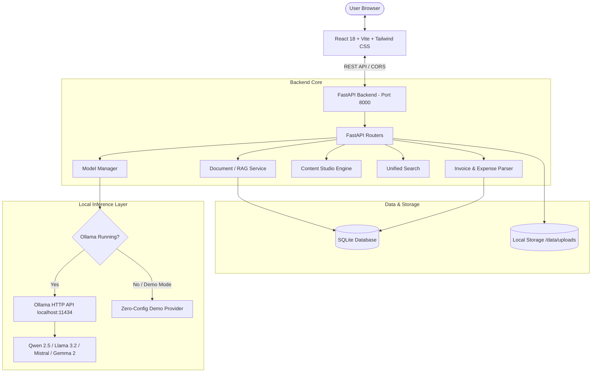

# 🛡️ LocalAI Sidekick

> **Privacy-First Local AI Workspace for Freelancers & Small Businesses**  
> *100% on-device AI inference powered by open-weight models (Ollama) — Zero API subscriptions, zero data leaks.*

---

[](https://fastapi.tiangolo.com)
[](https://www.python.org/)
[](https://react.dev/)
[](https://www.typescriptlang.org/)
[](https://vitejs.dev/)
[](https://tailwindcss.com/)
[](https://ollama.ai/)
[](#-testing)
[](LICENSE)

---

## 📖 Table of Contents

- [Why LocalAI Sidekick?](#-why-localai-sidekick)
- [Key Features](#-key-features)
- [System Architecture](#-system-architecture)
- [Project Directory Structure](#-project-directory-structure)
- [Getting Started](#-getting-started)
  - [Prerequisites](#prerequisites)
  - [Backend Setup](#1-backend-setup)
  - [Frontend Setup](#2-frontend-setup)
  - [Running with Ollama (Recommended)](#3-running-with-ollama-recommended)
  - [Zero-Config Demo Mode](#4-zero-config-demo-mode)
- [Configuration & Environment Variables](#-configuration--environment-variables)
- [Compatible Models & Hardware Guide](#-compatible-models--hardware-guide)
- [API Overview](#-api-overview)
- [Testing & Quality Assurance](#-testing--quality-assurance)
- [Contributing](#-contributing)
- [License](#-license)

---

## 💡 Why LocalAI Sidekick?

Freelancers, independent consultants, and small business owners regularly handle confidential client files:
- **Non-Disclosure Agreements (NDAs)** and commercial contracts
- **Financial invoices, bank statements, and tax receipts**
- **Proprietary project roadmaps and client correspondence**

Sending this proprietary information to cloud-hosted proprietary LLMs introduces compliance liabilities, potential data leak vectors, and ongoing monthly subscription or token costs.

**LocalAI Sidekick** eliminates these risks:
- 🔒 **100% On-Device:** Data never leaves your machine. Inference runs on your local CPU/GPU.
- 💸 **Zero Recurring API Fees:** Powered by open-weight models (`Qwen 2.5`, `Llama 3.2`, `Mistral`, `Gemma 2`, `Phi-3.5`).
- ⚡ **Offline-Ready:** Works with zero internet connection once models are downloaded.
- 🎯 **Domain-Specific Workflows:** Purpose-built for freelance document intelligence, automated expense extraction, and client communications.

---

## ✨ Key Features

### 📑 1. Grounded Document Intelligence (Local RAG)
- Upload contracts, RFPs, briefs, and client notes in `.pdf`, `.txt`, `.md`, or `.csv` format.
- Interactive question-answering powered by local embedding and generation models.
- **Verifiable citations:** Every answer cites source page numbers and exact text snippets so you can verify before acting.

### 🧾 2. Automated Invoice & Expense Extraction
- Drag and drop invoices and receipts (PDF, plain text, or images).
- Automatically parses:
  - **Vendor / Merchant name**
  - **Invoice number & Issue/Due dates**
  - **Subtotal, Tax, and Total amounts with currency detection**
  - **Smart category tagging** (*Software & Subscriptions*, *Office*, *Hardware*, *Travel*, etc.)
  - **Line items breakdown**
- One-click **CSV export** formatted for instant import into QuickBooks, Xero, or spreadsheets.

### ✍️ 3. Freelancer Content & Communication Studio
- Production-ready prompt templates crafted specifically for freelance operations:
  - Client Proposals & Statements of Work (SOW)
  - Standard Freelance Agreements & NDA summaries
  - Payment reminder & scope-change emails
  - Technical blog drafts & project case studies
- Configurable tone (Professional, Friendly, Firm, Concise) with variable injection.

### 🔍 4. Unified Fast Search
- Universal search bar scanning indexed documents, processed invoices, and studio notes.
- Highlights matched excerpts with quick-action shortcuts.

### 🦙 5. Dynamic Model Management & Fallback
- Real-time status detection for your local [Ollama](https://ollama.ai) daemon.
- Switch seamlessly between installed models (`qwen2.5:3b`, `llama3.2:3b`, `mistral:7b`, etc.).
- **Built-in Mock Demo Provider:** If Ollama is not installed or offline, the app gracefully falls back to simulated responses so you can test all UI flows instantly.

### 🌐 6. DEV.to & Technical Community Hub
- Integrated developer feed pulling top community articles, local AI setup guides, and developer prompts directly from DEV.to.

---

## 🏗️ System Architecture



---

## 📁 Project Directory Structure

```text
Week-2 Task/
├── backend/
│   ├── app/
│   │   ├── models/            # Pydantic schemas and data contracts
│   │   ├── providers/         # LLM providers (Ollama & Mock Demo fallback)
│   │   ├── routes/            # FastAPI API route handlers
│   │   │   ├── dashboard.py   # Overview statistics & system health
│   │   │   ├── devrelay.py    # DEV.to community feed & integration
│   │   │   ├── documents.py   # Document upload & RAG Q&A
│   │   │   ├── invoices.py    # Invoice parsing & CSV export
│   │   │   ├── models.py      # Ollama status & model selection
│   │   │   ├── search.py      # Unified global search
│   │   │   └── studio.py      # Content & proposal generation
│   │   ├── services/          # Core business logic (RAG, PyMuPDF, Invoices)
│   │   ├── utils/             # Security guards, sanitizers & sample data seeder
│   │   ├── config.py          # App settings & environment resolution
│   │   ├── database.py        # SQLite schema & query helpers
│   │   └── main.py            # FastAPI entry point & lifespan
│   ├── data/                  # SQLite DB & uploaded document storage (local)
│   ├── tests/                 # Backend automated test suite (Pytest)
│   ├── requirements.txt       # Python backend dependencies
│   └── run.py                 # Development backend server launcher
├── frontend/
│   ├── src/
│   │   ├── api/               # Typed API client functions
│   │   ├── components/        # Reusable UI components & layouts
│   │   ├── context/           # React context for active model & app state
│   │   ├── pages/             # Route views (Dashboard, Documents, Invoices, Studio, etc.)
│   │   ├── types/             # TypeScript data interfaces
│   │   ├── App.tsx            # Navigation and layout shell
│   │   ├── index.css          # Tailwind CSS base styles
│   │   └── main.tsx           # React DOM mount point
│   ├── package.json           # Frontend dependencies & scripts
│   ├── tsconfig.json          # TypeScript compiler configuration
│   └── vite.config.ts         # Vite bundler configuration
├── pytest.ini                 # Pytest configuration
└── README.md                  # Project documentation
```

---

## 🚀 Getting Started

### Prerequisites

- **Python**: version 3.10, 3.11, or 3.12 installed.
- **Node.js**: version 18.0.0 or higher (with `npm`).
- *(Optional, for live local AI)* **Ollama**: [Download Ollama](https://ollama.ai/download) for macOS, Linux, or Windows.

---

### 1. Backend Setup

1. Open your terminal in the project root:
   ```bash
   cd "Week-2 Task"
   ```

2. Create and activate a Python virtual environment:
   ```bash
   # Windows (PowerShell)
   python -m venv venv
   .\venv\Scripts\Activate.ps1

   # macOS / Linux
   python3 -m venv venv
   source venv/bin/activate
   ```

3. Install required Python packages:
   ```bash
   pip install -r backend/requirements.txt
   ```

4. Launch the FastAPI server:
   ```bash
   python backend/run.py
   ```
   *The backend will start at `http://127.0.0.1:8000` with interactive Swagger docs at `http://127.0.0.1:8000/docs`.*

---

### 2. Frontend Setup

1. In a new terminal window, navigate to the `frontend` folder:
   ```bash
   cd "Week-2 Task/frontend"
   ```

2. Install dependencies:
   ```bash
   npm install
   ```

3. Start the Vite development server:
   ```bash
   npm run dev
   ```
   *Open your browser and visit `http://localhost:5173`.*

---

### 3. Running with Ollama (Recommended)

To run actual 100% local inference on your hardware:

1. Install Ollama from [ollama.ai](https://ollama.ai).
2. Pull your preferred models:
   ```bash
   # Fast, lightweight model for laptops (recommended default)
   ollama pull qwen2.5:3b

   # High-quality embeddings for document search
   ollama pull nomic-embed-text

   # Optional alternative models
   ollama pull llama3.2:3b
   ollama pull mistral:7b
   ```
3. Start the Ollama daemon:
   ```bash
   ollama serve
   ```
4. Refresh LocalAI Sidekick — the status indicator in the top navbar will display **"Ollama Online"** with your active model.

---

### 4. Zero-Config Demo Mode

Don't have Ollama installed yet or running on a low-spec machine?  
No problem! LocalAI Sidekick includes a built-in **Mock Demo Provider**:
- Automatically activated if Ollama is unreachable.
- Can be manually toggled via the **Models** tab or header badge.
- Generates realistic contextual responses, citations, and structured extraction so you can explore the entire workflow.

---

## ⚙️ Configuration & Environment Variables

You can customize runtime behavior using environment variables or a `.env` file in the root directory:

| Variable | Default Value | Description |
| :--- | :--- | :--- |
| `OLLAMA_BASE_URL` | `http://localhost:11434` | URL of the local Ollama instance |
| `DEFAULT_MODEL` | `qwen2.5:3b` | Default text generation model tag |
| `EMBEDDING_MODEL` | `nomic-embed-text` | Model used for semantic search embeddings |
| `DEMO_MODE` | `false` | Force demo mode even when Ollama is running (`true`/`false`) |
| `DEV_API_KEY` | *(empty string)* | Optional DEV.to API key for publishing articles |

---

## 🧠 Compatible Models & Hardware Guide

| Model Tag | Parameters | Minimum RAM | Recommended Hardware | Best For |
| :--- | :--- | :--- | :--- | :--- |
| `qwen2.5:3b` | 3 Billion | 4 GB | Any Modern CPU / M-series / 4GB VRAM | Daily fast document Q&A and contract drafting |
| `llama3.2:3b` | 3 Billion | 4 GB | Modern CPU / 4GB VRAM | Natural client communication & summaries |
| `gemma2:2b` | 2 Billion | 3 GB | Ultra-lightweight laptops | Instant invoice classification & extraction |
| `mistral:7b` | 7 Billion | 8 GB | 8GB+ RAM / 6GB+ VRAM GPU | Deep legal/contractual reasoning |
| `nomic-embed-text`| 137 Million | 1 GB | Any CPU | Fast, local vector embeddings |

---

## 🔌 API Overview

FastAPI provides an auto-generated, interactive OpenAPI documentation page accessible at:  
👉 **`http://localhost:8000/docs`**

### Key Endpoints:
- `GET  /api/health` — System status and local inference confirmation
- `GET  /api/dashboard/stats` — Metrics, spend summaries, and recent activity
- `GET  /api/documents` — List uploaded documents
- `POST /api/documents/upload` — Upload PDF, TXT, MD, or CSV files
- `POST /api/documents/{doc_id}/ask` — Grounded RAG Q&A with citations
- `GET  /api/invoices` — List parsed invoices & expenses
- `POST /api/invoices/upload` — Extract financial data from receipt/invoice
- `GET  /api/invoices/export` — Export financial records to CSV
- `POST /api/studio/generate` — Generate client proposals, contracts & emails
- `GET  /api/search` — Unified keyword & semantic search
- `GET  /api/models/status` — Check Ollama connection & catalog
- `POST /api/models/demo-mode` — Toggle demo simulation mode

---

## 🧪 Testing & Quality Assurance

### Run Backend Unit & Integration Tests

From the project root:
```bash
pytest
```
*Pytest runs full verification against API endpoints, security sanitization, document text parsers, and financial heuristics.*

### Build Frontend Production Assets

From the `frontend` folder:
```bash
npm run build
```
*Compiles TypeScript and outputs optimized static bundles to `frontend/dist`.*

---

## 🛡️ Security & Privacy Architecture

- **Zero Remote Telemetry:** No user documents, prompts, or financial figures are transmitted to external servers.
- **Local Persistence:** Data resides exclusively in local SQLite database files located in `backend/data/`.
- **Upload Validation:** Strict MIME-type checking, file extension validation, and sanitization prevent malicious uploads.
- **Prompt Guards:** Prompt injection barriers and regex safety guards protect local model execution.

---

## 🤝 Contributing

Contributions, issues, and feature requests are welcome!
1. Fork the repository
2. Create your feature branch (`git checkout -b feature/amazing-feature`)
3. Commit your changes (`git commit -m "Add amazing feature"`)
4. Run tests (`pytest && npm run build`)
5. Push to the branch (`git push origin feature/amazing-feature`)
6. Open a Pull Request

---

## 📄 License

This project is licensed under the **MIT License**. See the [LICENSE](LICENSE) file for details.
